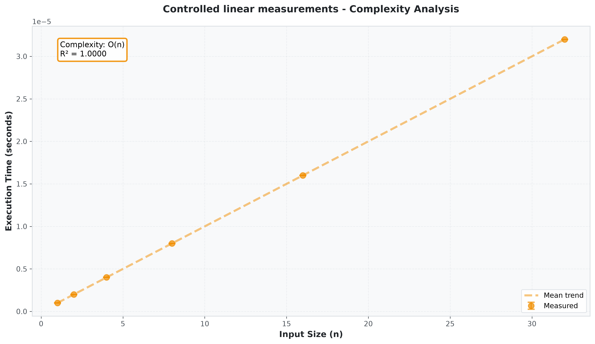

# Complexity Profiler

An educational Python toolkit for measuring algorithms and comparing finite timing
samples with candidate growth curves. It collects timings and operation counts,
summarizes repeated runs, exports JSON/CSV, and plots measured trends.

A fitted curve is an empirical estimate, **not a proof of an algorithm's Big-O class**.
Short runs, interpreter overhead, input distributions, caches and system load can
make several models indistinguishable. The profiler explicitly reports such cases
as `Inconclusive` and retains the measurements and candidate scores.

## Install and run

Python 3.10 or newer is required.

```bash
git clone https://github.com/ah682/complexity-profiler.git
cd complexity-profiler
python -m venv .venv
# Linux/macOS:
. .venv/bin/activate
# Windows PowerShell: .venv\Scripts\Activate.ps1
python -m pip install .
complexity-profiler list-algorithms
complexity-profiler analyze merge_sort --sizes 100,500,1000,5000 --runs 10 --no-visualize
complexity-profiler analyze insertion_sort --sizes 50,100,200,400 --runs 5 --no-visualize --export json --output result.json
complexity-profiler compare merge_sort heap_sort --sizes 100,500,1000 --runs 5 --save-chart comparison.png
```

The installed command works outside the source directory. Use `--help` on any
command for options. `--save-chart chart.png` saves a chart for `analyze`; use
`--no-visualize` for a terminal-only run. JSON preserves raw measurements and fit
scores; the CSV export contains per-size aggregates, rather than a full round trip.

## Use as a library

```python
from complexity_profiler.analysis.curve_fitting import fit_to_complexity, InconclusiveFitError

sizes = [1, 2, 4, 8, 16, 32]
times = [1e-6, 2e-6, 4e-6, 8e-6, 16e-6, 32e-6]
try:
    complexity, score = fit_to_complexity(sizes, times, min_r_squared=0.8)
    print(complexity, score)  # O(n), 1.0 for these controlled samples
except InconclusiveFitError as error:
    print(error, error.candidate_scores)
```

`ComplexityFitter.candidate_scores` exposes all six candidate scores after a fit.
`AlgorithmProfiler` keeps raw metrics, per-size statistics and the best candidate
score even when its `ProfileResult.empirical_complexity` is `Inconclusive`; the
reason appears in `notes` and scores in `candidate_scores`. Successful direct
fitter calls retain the `(ComplexityClass, r_squared)` return type. Inconclusive
direct fits raise `InconclusiveFitError`, a `RuntimeError` subclass.

## Fitting assumptions and limitations

- Supply at least three **distinct positive** sizes and matching one-dimensional,
  finite, nonnegative timings; at least one timing must be positive. Invalid data
  raises `ValueError`. Thresholds must be finite and between 0 and 1.
- Models are constant, logarithmic, linear, linearithmic, quadratic and cubic,
  each with an intercept and a nonnegative growth coefficient. Exponential and
  factorial are enum labels, not supported fit candidates.
- Timing values are normalized before least squares. Polynomial bases scale sizes
  before taking powers; the linearithmic basis keeps the original size logarithm.
  These positive basis scalings preserve each affine model while avoiding numeric
  overflow/underflow. Public curve functions keep their original coefficient units.
  An unrepresentable candidate is inconclusive, never a fabricated zero score.
  Changing seconds to another timing unit does not change the fit. Exactly flat
  positive samples receive a constant fit; small variation is not treated as flat.
- A candidate must meet `min_r_squared`. Candidates within 0.02 R² **and** twice
  the best residual error are considered ambiguous, with a 64-machine-epsilon
  residual floor for numerical equality. This is a documented heuristic, not a
  confidence interval or a statistical significance test.
- R² describes the sampled range only. Expand the size range, inspect candidate
  scores, and consider deterministic operation counts before interpreting growth.
  Instrumentation adds overhead. Repeated runs reduce some noise but do not remove
  environmental bias. Charts show observations and their mean trend.
- Search algorithms use the first list item as the target and remaining items as
  the search array. Ordered search algorithms require sorted data; the CLI's generic
  data generator does not establish an average-case search experiment.

## Reproducible chart

```bash
python examples/controlled_growth.py
```

This writes `controlled-growth.png` and `controlled-growth.json` from literal linear
measurements, so the example demonstrates fitting and plotting without claiming
that wall-clock measurements establish a particular asymptotic class.



## Contribute and verify

```bash
python -m pip install -r requirements-dev.txt
python -m pip install -e .
pytest
black --check --workers 1 complexity_profiler tests
isort --check-only complexity_profiler tests
flake8 complexity_profiler tests
mypy complexity_profiler
bandit -r complexity_profiler
python -m build
```

Alternatively, `uv sync --extra dev` installs the locked development environment;
run checks with `uv run`. CI checks formatting, types, security, tests and the
85% coverage gate on its configured OS/Python matrix. Local verification is not
proof that every matrix combination passes; see the workflow results for hosted
status. Bandit's per-call B311 annotations identify non-security random algorithm
pivots and synthetic data generation; other security checks remain enabled.

Bug reports should include Python/package versions, OS, input sizes, timing units,
raw data and candidate scores. For fitting changes, add deterministic regressions
with independently derived expected results across timing scales. Keep real timing
smoke tests separate from model correctness tests, and do not assert exact classes
from a short wall-clock run. Include regression evidence and run the full checks.

MIT licensed; see [LICENSE](LICENSE). See [CHANGELOG.md](CHANGELOG.md) for release
notes and [docs/EXPORT_README.md](docs/EXPORT_README.md) for export details.
